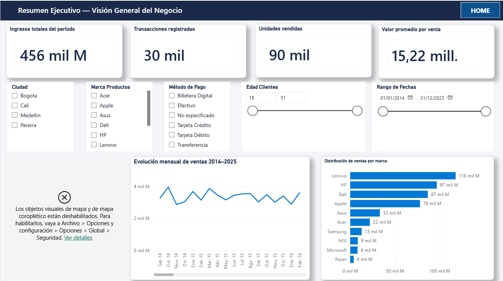
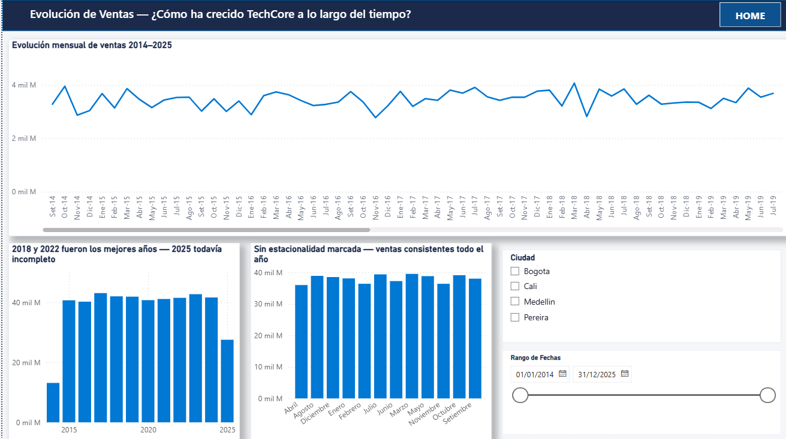

# Informe ejecutivo — Hallazgos de ventas 2014-2025

TechCore Analytics · Dashboard de Inteligencia de Negocio · Mauricio Melgarejo

Este informe resume, en lenguaje de negocio, los hallazgos del análisis de ventas de TechCore y qué decisiones comerciales habilitan. El detalle interactivo está en [`Avance_3/Avance_3_Dashboard_PowerBI.pbix`](Avance_3/Avance_3_Dashboard_PowerBI.pbix) (abrir con Power BI Desktop).

---

## 1. Resumen ejecutivo

El análisis de 30.000 transacciones (2014-2025, 6 sucursales en 4 ciudades de Colombia, $456 mil millones en ingresos) muestra un negocio estable que depende fuertemente de una sola ciudad y un desbalance de género en la base de clientes.

- **Medellín concentra el 43% de las ventas totales**, duplicando a la sucursal de menor rendimiento (Cali). El negocio depende de una plaza.
- **El 65% de las compras las hacen hombres** (11.366 clientes) frente al 35% de mujeres (6.087). El segmento femenino está subrepresentado sin una causa de demanda clara.
- **El HP Spectre x360 lidera con 7.726 unidades**, un 30% por encima del segundo lugar — es, por lejos, el producto más relevante del catálogo.
- **Las ventas no tienen estacionalidad**: se mantienen estables ($3-4M mensuales) durante los 11 años analizados, sin meses pico consistentes.
- **Hay una base de clientes fiel**: 17.453 clientes únicos sobre 30.000 ventas (~1,7 compras promedio por cliente).

**Impacto esperado:** la concentración en Medellín y el desbalance de género son las dos palancas de crecimiento más claras — ninguna de las dos requiere descubrir demanda nueva, sino capturar mejor la que ya existe en zonas y segmentos desatendidos.

---

## 2. Recomendaciones de negocio

1. **Desarrollar una estrategia de crecimiento comercial en Cali y Pereira** (13% del negocio cada una vs. 43% de Medellín). La distribución de clientes por edad y género es similar en todas las ciudades, por lo que la brecha no parece ser de demanda sino de presencia o capacidad de la sucursal local.
2. **Diseñar una propuesta comercial dirigida al segmento femenino**, hoy subrepresentado (35% de clientes), revisando si el catálogo y la comunicación actual están pensados principalmente para el comprador masculino.
3. **Priorizar stock y comunicación del HP Spectre x360** como producto ancla, y evaluar si una mayor disponibilidad en Cali y Pereira ayuda a esas plazas a crecer.
4. **Revisar la política de descuentos**: los descuentos aplicados no correlacionan con marca, ciudad, método de pago ni precio — hoy no se están usando como herramienta comercial dirigida.
5. **Evaluar a los vendedores por ingresos y por volumen de clientes atendidos**, no solo por un criterio: el equipo tiene perfiles complementarios (unos venden menos pero más caro, otros atienden más clientes con tickets menores) y evaluar con un solo número esconde esa diferencia.

---

## 3. Limitaciones y supuestos

- **El margen por marca es una estimación, no un dato real.** El dataset no incluye el costo unitario por producto, así que el margen se estimó por tramos de precio (equipos más caros → menor margen relativo). Es un supuesto documentado, no un hallazgo medido. Antes de tomar decisiones de pricing con este número, se recomienda incorporar el costo real del sistema de compras.
- El dataset es una muestra ficticia de una empresa ficticia (ejercicio del Módulo 3 de Henry), no datos de una operación real.
- Los 11 años de histórico vienen de 30.000 facturas limpias, posterior a eliminar 307 duplicados exactos — es importante tener ese proceso de limpieza presente al interpretar cualquier cifra de "total histórico".

---

## 4. Evidencia

Captura real del dashboard (Power BI Desktop) — página "Resumen Ejecutivo / KPIs Globales".

Captura real del dashboard — página "Evolución de Ventas", con filtro de ciudad disponible.

---

## 5. Metodología y fuentes

30.307 filas crudas de facturación (2014-2025), limpiadas en Power Query hasta 30.000 filas · modelo relacional de 8 tablas construido en Python (`Avance_2/`) · dashboard de Power BI con 6 páginas y Row Level Security (`Avance_3/`). Detalle completo del proceso de limpieza y modelado en el [README técnico](README.md) de este repositorio.
